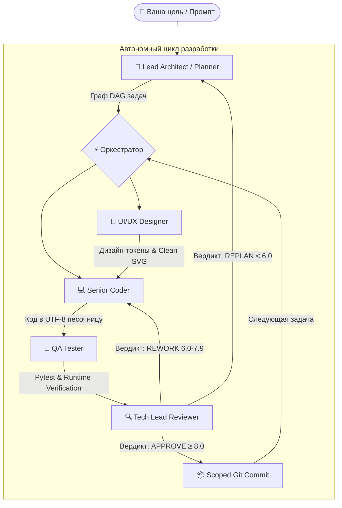

# ⚡ AI-Team Studio — Autonomous Multi-Agent Development Studio

> 🌐 **Официальный сайт и голосовой дневник разработки:** [alevoldon.github.io/ai-team-website](https://alevoldon.github.io/ai-team-website/)

---

## 🌟 Что такое AI-Team Studio?

**AI-Team Studio** — это автономная десктопная студия разработки программного обеспечения, где вы выступаете в роли **Team Lead / Product Manager**. Вместо ручного написания кода вы формулируете одну высокоуровневую цель, а автономная команда из 5 специализированных агентов берёт на себя полный цикл разработки:

---

## ✨ Ключевые возможности

### 1. 🤖 Автономная команда из 5 агентов
* **📐 Lead Architect (Planner):** Сканирует рабочее пространство и декомпозирует задачу в ориентированный ациклический граф (DAG).
* **🎨 UI/UX Designer:** Генерирует цветовую палитру, CSS-токены и чистые векторные SVG-иконки без «нейросетевого мусора» (Anti-Slop Protocol).
* **💻 Senior Coder:** Пишет чистый, идиоматичный код без плейсхолдеров (`# TODO`) через защищённый протокол правок.
* **🧪 QA Tester:** Запускает тесты в нативной изолированной песочнице с поддержкой UTF-8 (`pytest`, `node --test`).
* **🔍 Tech Lead Reviewer:** Проверяет код по **5-мерной матрице качества** (Architecture, Tests, Requirements, Code Quality, Security) и делает аккуратный точечный Git-коммит.

### 2. 🎙️ Двусторонняя голосовая связь (Voice 2.0 & Push-to-Talk)
* Синтез выразительной русской речи в реальном времени через **Gemini 3.8 Flash TTS**.
* Интерактивное голосовое управление Push-to-Talk: вы говорите голосом в микрофон, а ведущий архитектор отвечает вслух и выполняет команды по проекту.

### 3. 💰 Модель BYOK (Bring Your Own Key) & Нулевые расходы
* **100% приватность:** запуск на локальной видеокарте (через LM Studio или Ollama) с нулевой утечкой кода во внешнюю сеть.
* **Ультра-экономное облако:** поддержка DeepSeek V3, Google Gemini (Free Tier) и OpenRouter. Разработка полноценного приложения обходится от **$0.00** до **$0.01**.

### 4. 🪟 Нативное десктопное приложение
* Тёмная тема в киберпанк-стилистике, живой стриминг рассуждений агентов, визуальный граф DAG, статус-бар производительности (tok/s) и 8-битная векторная анимация персонажей.

---

## 🎮 Витрина проектов, созданных студией на 100% автономно

Все проекты ниже были спроектированы, запрограммированы и протестированы студией без единой строчки ручного кода:

| # | Проект | Стек | Описание | Верификация | Стоимость LLM |
|---|---|---|---|---|---|
| 1 | **Password & Hash Guard** | 🐍 Python | Валидатор сложности паролей, bcrypt и argon2 хеширование | 100% pytest | 18k tok • ~$0.005 |
| 2 | **Tic-Tac-Toe Minimax AI** | 🐍 Python | Консольная игра с непобедимым ботом Minimax | 100% pytest | 21k tok • ~$0.006 |
| 3 | **Battle City (NES Dendy 8-bit)** | 🐍 Python | Ретро-аркада: танки, физика снарядов, разрушаемый кирпич/сталь | 100% pytest + Smoke | 40k tok • ~$0.010 |
| 4 | **FinCalc CLI Suite** | 🐍 Python | Модульный финансовый калькулятор: вклады, кредиты, инфляция | 100% pytest | 86k tok • ~$0.015 |
| 5 | **Number Guessing Arena** | 🐍 Python | Игра с подсказками, динамическими диапазонами и таблицей рекордов | 100% pytest | 19k tok • ~$0.004 |
| 6 | **Rogue-lite Dungeon Crawler** | 🐍 Python | Пошаговая RPG: процедурные комнаты, прокачка уровней, инвентарь | 100% pytest | 144k tok • ~$0.024 |
| 7 | **Habit & Task Tracker** | 🟨 Node.js | Трекер привычек и задач со streak-счётчиком и JSON-хранилищем | 22/22 node:test | 43k tok • **$0.008** |

---

## 📜 История версий и релизов

* **v0.13.0 (Текущая)** — Модульный UI (`layout.html`, `styles.css`, `app.js`), мультипровайдерный биллинг моделей, нативный UTF-8 Windows Sandbox, ресайзер логов.
* **v0.12.0** — Voice Announcer 2.0, двусторонний Push-to-Talk чат с архитектором, каскадный пул моделей озвучки.
* **v0.11.0** — Матрица моделей NVIDIA Nemotron, единый гибридный Conductor.
* **v0.10.0** — Поддержка прямого Google Gemini API (Free Tier), пресеты команд в 1 клик.
* *Полная история всех 14 релизов доступна на сайте студии.*

---

## 💎 Доступ и приобретение лицензии

AI-Team Studio распространяется по коммерческой модели **Lifetime License (без ежемесячных подписок)**:

* **Public Showcase:** бесплатно — открытый голосовой дневник разработки и история версий на сайте.
* **Early Bird Pro:** **$19** разово (пожизненный доступ для первых пользователей) — полное десктопное приложение, 5 агентов, голосовой чат, неограниченные проекты.

Для связи с автором и получения раннего доступа: **Vladimir Rybalsky**  
Посетите интерактивную презентацию: **[https://alevoldon.github.io/ai-team-website/](https://alevoldon.github.io/ai-team-website/)**
