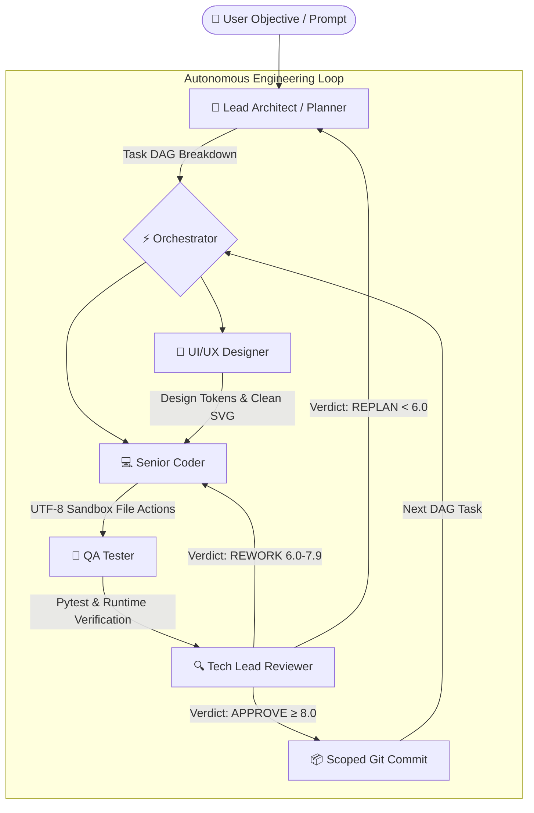

# ⚡ AI-Team Studio — Autonomous Multi-Agent Development Studio

[](https://alevoldon.github.io/ai-team-website/)
[]()
[]()
[]()
[]()

> 🌐 **Interactive Showcase & Voice Devlog:** [alevoldon.github.io/ai-team-website](https://alevoldon.github.io/ai-team-website/)  
> 🌍 **Languages:** [English](#-english) | [Русский](#-русский)

---

## 🏷️ GitHub Topics / Теги репозитория

Для максимального охвата на GitHub рекомендуется добавить в **About ⚙️** репозитория следующие топики:
```text
ai-agents, autonomous-agents, multi-agent-systems, developer-tools, code-generation, devlog, webview2, gemini-tts, local-llm, lmstudio, ollama, deepseek, software-engineering, showcase, desktop-studio
```

---

<a name="-english"></a>
## 🇬🇧 English

### 🌟 What is AI-Team Studio?

**AI-Team Studio** is a commercial autonomous desktop software development suite where you act as **Team Lead / Product Manager**. Instead of typing lines of code manually, you define a single high-level objective. A specialized crew of 5 autonomous AI agents handles the complete engineering lifecycle from DAG architecture to scoped Git commits:



### ✨ Key Capabilities

1. **🤖 Specialized 5-Agent Crew:**
   * **📐 Lead Architect (Planner):** Scans the project workspace and decomposes goals into a Directed Acyclic Graph (DAG) of atomic tasks.
   * **🎨 UI/UX Designer:** Crafts cohesive color palettes, typography tokens, and pure vector SVG assets (Anti-Slop Protocol).
   * **💻 Senior Coder:** Implements complete, idiomatic code without `# TODO` placeholders via an atomic edit protocol.
   * **🧪 QA Tester:** Executes tests inside a strict, isolated native UTF-8 sandbox (`pytest`, `node --test`).
   * **🔍 Tech Lead Reviewer:** Evaluates code across a **5-Dimensional Quality Matrix** (Architecture, Tests, Requirements, Quality, Security) before triggering scoped Git commits.

2. **🎙️ Two-Way Voice Dialogue (Gemini 3.8 Flash TTS & Push-to-Talk):**
   * Real-time expressive speech synthesis in Russian & English.
   * Hands-free push-to-talk voice commands: talk to the Lead Architect through your microphone, and hear spoken architectural feedback and status updates out loud.

3. **💰 BYOK Model (Bring Your Own Key) & Near-Zero Running Cost:**
   * **100% Privacy:** Runs completely offline on consumer GPUs (via LM Studio or Ollama) with zero code telemetry leaving your machine.
   * **Ultra-Affordable Cloud:** Native support for DeepSeek V3, Google Gemini (Free Tier), and OpenRouter. Building a full project typically costs between **$0.00** and **$0.01**.

4. **🖥️ Cyber-Dark Desktop Studio (WebView2):**
   * VS Code-inspired dark UI, streaming agent reasoning tokens, live DAG task graph, 8-bit vector animated pixel-art agent sprites, and real-time tok/s telemetry.

### 🎮 Battle-Tested Autonomous Showcase

Projects built, tested, and verified 100% autonomously by AI-Team Studio without manual coding:

| # | Project | Stack | Overview | Verification | LLM Tokens & Cost |
|---|---|---|---|---|---|
| 1 | **Password & Hash Guard** | 🐍 Python | Complexity validator, bcrypt & argon2 hashing | 100% pytest | 18k tok • ~$0.005 |
| 2 | **Tic-Tac-Toe Minimax AI** | 🐍 Python | Terminal game with unbeatable Minimax bot | 100% pytest | 21k tok • ~$0.006 |
| 3 | **Battle City (NES Dendy 8-bit)** | 🐍 Python | Retro arcade: player tank, enemy AI, destructible blocks | 100% pytest + Smoke | 40k tok • ~$0.010 |
| 4 | **FinCalc CLI Suite** | 🐍 Python | Financial calculator: compound interest, loan schedules | 100% pytest | 86k tok • ~$0.015 |
| 5 | **Number Guessing Arena** | 🐍 Python | Interactive CLI game with dynamic hints & leaderboards | 100% pytest | 19k tok • ~$0.004 |
| 6 | **Rogue-lite Dungeon Crawler** | 🐍 Python | Procedural turn-based RPG with character progression | 100% pytest | 144k tok • ~$0.024 |
| 7 | **Habit & Task Tracker** | 🟨 Node.js | Multi-stack habit tracker with JSON persistence | 22/22 node:test | 43k tok • **$0.008** |

### 💎 Commercial Pricing & Early Bird Access

* **Public Showcase:** Free — browse the changelog, devlog articles, and audio reviews on the website.
* **Early Bird Pro License:** **$19 one-time** *(regular $29)* — full desktop suite, all 5 agents, voice dialogue, perpetual updates.

Author & Copyright: **Vladimir Rybalsky**  
👉 **Live Web App & Voice Demos:** [alevoldon.github.io/ai-team-website](https://alevoldon.github.io/ai-team-website/)

---

<a name="-русский"></a>
## 🇷🇺 Русский

### 🌟 О проекте AI-Team Studio

**AI-Team Studio** — это автономная десктопная среда разработки программного обеспечения, в которой вы выступаете в роли **Team Lead / Product Manager**. Вместо ручного набора кода вы формулируете одну высокоуровневую задачу. Автономная команда из 5 специализированных агентов выполняет полный инженерный цикл: от проектирования графа задач (DAG) до тестирования в песочнице и создания точечных коммитов в Git.

### ✨ Главные преимущества

1. **🤖 Команда из 5 агентов-специалистов:**
   * **📐 Lead Architect (Planner):** Сканирует рабочее пространство и декомпозирует проект в ориентированный ациклический граф задач (DAG).
   * **🎨 UI/UX Designer:** Создаёт гармоничную цветовую схему, CSS-токены и чистые векторные SVG-иконки без «нейросетевого мусора» (Anti-Slop Protocol).
   * **💻 Senior Coder:** Пишет чистый, работающий код без заглушек (`# TODO`) через защищённый протокол редактирования файлов.
   * **🧪 QA Tester:** Запускает тесты в изолированной нативной UTF-8 песочнице (`pytest`, `node --test`).
   * **🔍 Tech Lead Reviewer:** Оценивает код по **5-мерной матрице качества** (Architecture, Tests, Requirements, Quality, Security) и формирует аккуратный Git-коммит.

2. **🎙️ Двусторонняя голосовая связь (Voice 2.0 & Push-to-Talk):**
   * Выразительный речевой синтез русской речи на базе **Gemini 3.8 Flash TTS**.
   * Интерактивное голосовое управление: говорите с ведущим архитектором через микрофон и слушайте его ответы в реальном времени.

3. **💰 Модель BYOK (Bring Your Own Key) & Разработка за копейки:**
   * **100% приватность:** запуск на локальной видеокарте (через LM Studio или Ollama) без передачи кода во внешнюю сеть.
   * **Экономное облако:** поддержка DeepSeek V3, Google Gemini (Free Tier) и OpenRouter. Создание готового приложения обходится от **$0.00** до **$0.01**.

4. **🖥️ Десктопное приложение в тёмных тонах (WebView2):**
   * Живой стриминг рассуждений агентов, визуальный граф задач, пиксельные 8-битные персонажи и мониторинг скорости генерации (tok/s).

### 🎮 Витрина проектов, созданных студией на 100% автономно

Все проекты протестированы и верифицированы без ручного вмешательства человека:
* 🐍 **Password & Hash Guard** (Python, bcrypt, argon2) — 18k tok • ~$0.005
* 🐍 **Tic-Tac-Toe Minimax AI** (Python, непобедимый бот) — 21k tok • ~$0.006
* 🐍 **Battle City (NES Dendy 8-bit)** (Python, аркада с танками) — 40k tok • ~$0.010
* 🐍 **FinCalc CLI Suite** (Python, финансовый калькулятор) — 86k tok • ~$0.015
* 🐍 **Number Guessing Arena** (Python, игра с рекордами) — 19k tok • ~$0.004
* 🐍 **Rogue-lite Dungeon Crawler** (Python, пошаговая RPG) — 144k tok • ~$0.024
* 🟨 **Habit & Task Tracker** (Node.js, трекер привычек) — 43k tok • **$0.008**

### 💎 Доступ и приобретение лицензии

* **Public Showcase:** Бесплатно — открытый дневник разработки и история версий на сайте.
* **Early Bird Pro:** **$19 разово** *(вместо $29)* — пожизненная десктопная лицензия, 5 агентов, голосовой чат, все обновления.

Автор и правообладатель: **Vladimir Rybalsky**  
👉 **Интерактивная презентация и голосовые обзоры:** [alevoldon.github.io/ai-team-website](https://alevoldon.github.io/ai-team-website/)
