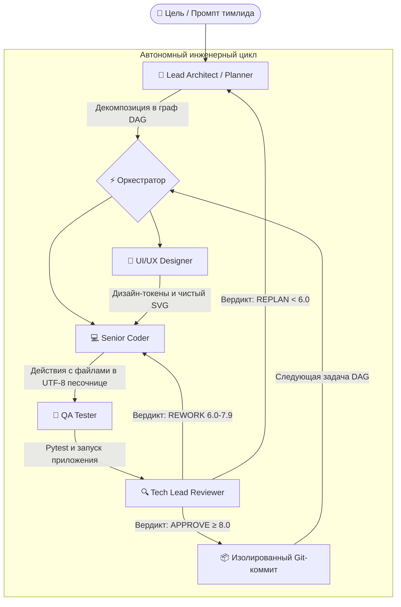

# ⚡ AI-Team Studio
### Автономная мультиагентная студия десктопной разработки ПО

---

**Языки / Languages:**  
**[Русский](README_RU.md)** • **[English](README.md)**

🌐 **Интерактивная презентация и голосовой девлог:** [alevoldon.github.io/ai-team-website](https://alevoldon.github.io/ai-team-website/)

---

## 🌟 Что такое AI-Team Studio?

**AI-Team Studio** — это коммерческая автономная десктопная среда разработки программного обеспечения, в которой вы выступаете в роли **Team Lead / Product Manager**. Вместо ручного набора кода вы формулируете одну высокоуровневую задачу. Автономная команда из 5 специализированных агентов выполняет полный инженерный цикл: от проектирования графа задач (DAG) до тестирования в песочнице и создания точечных коммитов в Git:

---

## ✨ Главные возможности и модули студии

### 1. 🤖 Команда из 5 агентов-специалистов
* **📐 Lead Architect (Planner):** Сканирует рабочее пространство и декомпозирует проект в ориентированный ациклический граф задач (DAG) с контролем зависимостей.
* **🎨 UI/UX Designer:** Создаёт гармоничную цветовую схему, CSS-токены, типографику и чистые векторные SVG-иконки без «нейросетевого мусора» (Anti-Slop Protocol).
* **💻 Senior Coder:** Пишет чистый, работающий код без заглушек (`# TODO`) через защищённый протокол атомарного редактирования файлов.
* **🧪 QA Tester:** Запускает тесты в изолированной нативной UTF-8 песочнице (`pytest`, `node --test`, проверка запуска entrypoint).
* **🔍 Tech Lead Reviewer:** Оценивает код по **5-мерной матрице качества** (Architecture, Tests, Requirements, Quality, Security) и формирует аккуратный Git-коммит.

### 2. 🎙️ Двусторонняя голосовая связь (Voice 2.0 & Push-to-Talk)
* Выразительный речевой синтез русской и английской речи на базе **Gemini 3.8 Flash TTS**.
* Интерактивное голосовое управление: говорите с ведущим архитектором через микрофон и слушайте его ответы в реальном времени.
* Автоматический каскадный пул обхода лимитов исключает ошибки квот 429.

### 3. 💰 Модель BYOK (Bring Your Own Key) & Разработка за копейки
* **100% приватность:** запуск на локальной видеокарте (через LM Studio или Ollama) без передачи кода во внешнюю сеть.
* **Экономное облако:** поддержка DeepSeek V3, Google Gemini (Free Tier), NVIDIA Nemotron и OpenRouter. Создание готового приложения обходится от **$0.00** до **$0.01**.

### 4. 🖥️ Десктопное приложение в тёмных тонах (WebView2)
* Живой стриминг рассуждений агентов, визуальный граф задач, пиксельные 8-битные персонажи и мониторинг скорости генерации (tok/s).

### 5. 🛡️ Dual-Repo архитектура защиты кода (Zero Code Leakage)
* Исходный код ядра студии полностью изолирован в закрытом локальном репозитории.
* Публичный веб-репозиторий содержит исключительно презентационную витрину, звуковые дорожки обзоров и историю версий, исключая утечку приватного кода.

### 6. 🔄 Автоматическая синхронизация витрины (`sync_website.py`)
* Синхронизирует релизы из `CHANGELOG.md`, подсчитывает тесты (197+ тестов) и генерирует данные для сайта в один клик.

---

## 🌐 Возможности веб-витрины студии

Официальный сайт проекта ([alevoldon.github.io/ai-team-website](https://alevoldon.github.io/ai-team-website/)) включает:
* **🕹️ Интерактивный симулятор:** наглядная демонстрация передачи задач между агентами с просмотром диффов кода.
* **🎙️ Голосовой девлог-подкаст:** 14 выпусков аудио-обзоров с визуализацией звуковой волны и регулировкой скорости (0.75x–2.0x).
* **📜 Полная история версий:** 14 релизов (`v0.1.0` – `v0.13.0`) с фильтрацией по тегам (`ALL`, `DESKTOP`, `VOICE`, `CORE`, `TESTING`, `SHOWCASE`).
* **🌐 100% двуязычность:** мгновенное переключение между RU и EN для всех карточек, списков и модальных окон.
* **📱 Адаптивный кибер-дизайн:** сетка masonry, мобильное меню-шторка и солидный 4-колоночный футер с индикацией статуса системы.

---

## 🎮 Витрина проектов, созданных студией на 100% автономно

Все проекты протестированы и верифицированы без ручного вмешательства человека:

| # | Проект | Стек | Описание и модули | Верификация | Токены и затраты |
|---|---|---|---|---|---|
| 1 | **Password & Hash Guard** | 🐍 Python | Валидатор паролей, хеширование bcrypt и argon2 | 100% pytest | 18k tok • ~$0.005 |
| 2 | **Tic-Tac-Toe Minimax AI** | 🐍 Python | Консольная игра с непобедимым ботом Minimax | 100% pytest | 21k tok • ~$0.006 |
| 3 | **Battle City (NES Dendy 8-bit)** | 🐍 Python | Ретро-аркада: танк игрока, AI врагов, разрушаемые блоки | 100% pytest + Smoke | 40k tok • ~$0.010 |
| 4 | **FinCalc CLI Suite** | 🐍 Python | Финансовый калькулятор: сложные проценты, графики кредитов | 100% pytest | 86k tok • ~$0.015 |
| 5 | **Number Guessing Arena** | 🐍 Python | Интерактивная игра с подсказками и рекордами | 100% pytest | 19k tok • ~$0.004 |
| 6 | **Rogue-lite Dungeon Crawler** | 🐍 Python | Пошаговая процедурная RPG с прокачкой героя | 100% pytest | 144k tok • ~$0.024 |
| 7 | **Habit & Task Tracker** | 🟨 Node.js | Мульти-стек трекер привычек с JSON-хранилищем | 22/22 node:test | 43k tok • **$0.008** |

---

## 💎 Доступ и приобретение лицензии

| Тариф | Стоимость | Описание и возможности |
|---|---|---|
| **Public Showcase** | **$0** (Открытый доступ) | Чтение дневника разработки, прослушивание голосовых обзоров версий, изучение каталога проектов. |
| **AI-Team Pro Studio** | **$19 разово** *(Early Bird, вместо $29)* | Нативное Windows GUI приложение (WebView2), все 5 агентов, Push-to-Talk голосовой чат, 100% локальная работа на GPU, вечные обновления. |
| **Team / Agency Edition** | **$49 пожизненно** | Всё из тарифа Pro Studio, кастомные роли агентов и системные промпты, мульти-стек архитектура и персональная поддержка от автора. |

---

## 👤 Автор и правообладатель

**Создатель, архитектор и разработчик:** **Vladimir Rybalsky**  
👉 **Интерактивная презентация и голосовые обзоры:** [alevoldon.github.io/ai-team-website](https://alevoldon.github.io/ai-team-website/)
